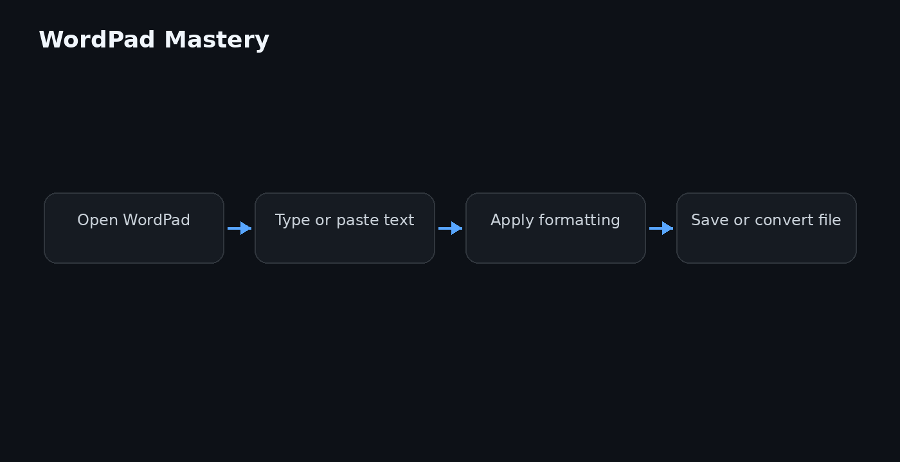

# WordPad Text Editing Guide




## Overview

This repository is a practical guide to WordPad text editing — from basic formatting to advanced document workflows. It covers the WordPad interface, file formats, automation through the command line, and integration with other Windows text tools. Whether you are new to WordPad or looking to speed up everyday text editing, this guide gives you clear, tested steps.

## Why it exists

WordPad is often overlooked. It ships with Windows, needs no installation, and handles rich text, plain text, and Word documents. Yet most users only scratch the surface of WordPad text editing: they use it as a plain notepad substitute and miss formatting, embedding objects, and scripting.

This guide exists to close that gap. It collects the practical knowledge of WordPad text editing into one place — keyboard shortcuts, file format behavior, and automation examples — so you can use WordPad deliberately instead of by accident.

## Core concepts

- **Rich text vs. plain text**: WordPad edits RTF natively but also opens and saves `.txt` and `.docx` files. Know which format you are working in before you save.
- **Formatting model**: WordPad applies character, paragraph, and page-level formatting. The ribbon groups these controls; the ruler and status bar give live feedback.
- **Object embedding**: WordPad supports OLE objects (images, spreadsheets, equations) via *Insert Object*. These are embedded, not linked, in most cases.
- **File compatibility**: WordPad reads `.docx` but writes RTF by default. This affects how your documents behave when shared.
- **Automation boundary**: WordPad has no built-in macro language. Automation happens through command-line arguments, PowerShell, or SendKeys — not through a native scripting API.

## Architecture


The diagram above shows the layered structure of a typical WordPad text editing session:

1. **Shell layer**: The Windows Explorer file association routes `.rtf`, `.txt`, and `.docx` files to WordPad.
2. **Application layer**: The WordPad executable (`write.exe`) manages the document window, ribbon, and undo stack.
3. **Document model**: Internally, WordPad works with a rich text stream. Formatting is stored inline as RTF control words.
4. **I/O layer**: File read/write goes through Windows file APIs. Format conversion happens at load and save time.
5. **OLE layer**: Embedded objects are managed by the OLE subsystem, separate from the text stream.

This structure explains why WordPad is fast for small documents but not suited for large, indexed text editing tasks.

## Practical workflow

A reliable WordPad text editing workflow looks like this:

1. **Open the file** — use `write.exe` with a file path, or right-click → *Open with* → *WordPad*.
2. **Check the format** — look at the title bar or *File → Properties* to confirm RTF, TXT, or DOCX.
3. **Set page layout first** — adjust margins, orientation, and paper size before writing long content.
4. **Write and format** — use keyboard shortcuts for bold, italic, lists, and alignment. Apply styles consistently.
5. **Insert objects** — add images or other OLE objects only after the surrounding text is stable.
6. **Save deliberately** — choose RTF for rich text, TXT for plain text, DOCX only when Word compatibility is required.
7. **Verify output** — reopen the saved file to confirm formatting survived the round trip.

## Examples

### Launch WordPad with a file

```cmd
write.exe C:\docs\notes.rtf
```

### Convert a text file to RTF using PowerShell

```powershell
$content = Get-Content -Path "C:\docs\plain.txt" -Raw
$rtf = "<{\rtf1\ansi " + $content + "}>"
Set-Content -Path "C:\docs\formatted.rtf" -Value $rtf
```

This is a minimal conversion. Real-world RTF needs escaping for special characters.

### Send formatted text to WordPad via SendKeys

```powershell
$wordpad = New-Object -ComObject WScript.Shell
$wordpad.AppActivate("WordPad")
Start-Sleep -Milliseconds 300
$wordpad.SendKeys("Hello World{ENTER}")
$wordpad.SendKeys("^b")  # Ctrl+B for bold
$wordpad.SendKeys("Bold text")
```

### Batch-convert multiple RTF files to plain text

```cmd
for %f in (*.rtf) do (
  write.exe /p "%f"
)
```

The `/p` flag prints the file, which can then be captured by a virtual printer. For silent conversion, a third-party tool is more reliable than WordPad alone.

### Check file format before opening

```powershell
$bytes = [System.IO.File]::ReadAllBytes("C:\docs\sample.rtf")
if ($bytes[0] -eq 0x7B) { "Looks like RTF (starts with '{')" }
```

## FAQ

**Does WordPad support macros?**  
No. WordPad has no macro recorder or scripting language. Use AutoHotkey or PowerShell for automation.

**Can WordPad open `.docx` files?**  
Yes, it can open them, but it saves in RTF by default. Complex Word features (track changes, styles, footnotes) are lost.

**Why does my RTF file look different in Word?**  
WordPad and Word interpret some RTF control words differently. Stick to basic formatting to keep output consistent.

**How do I insert a table?**  
WordPad does not support tables. Use a spreadsheet or a word processor with table support instead.

**Is WordPad available on all Windows versions?**  
It ships with most Windows editions, but it was removed from Windows 11 24H2 and later. Check your system before relying on it.

**Can I edit large files in WordPad?**  
WordPad handles small to medium files well. For very large files, it becomes slow and may truncate content. Use a dedicated editor.

## License

MIT

Topic: `wordpad-text-editing`
